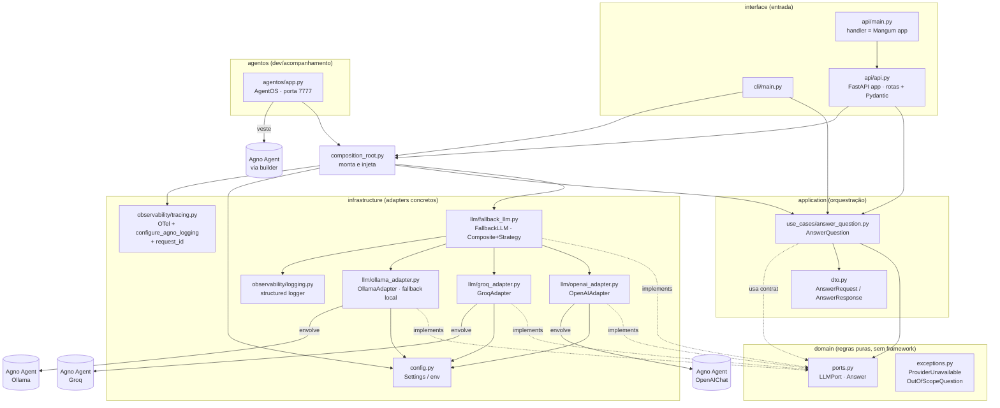
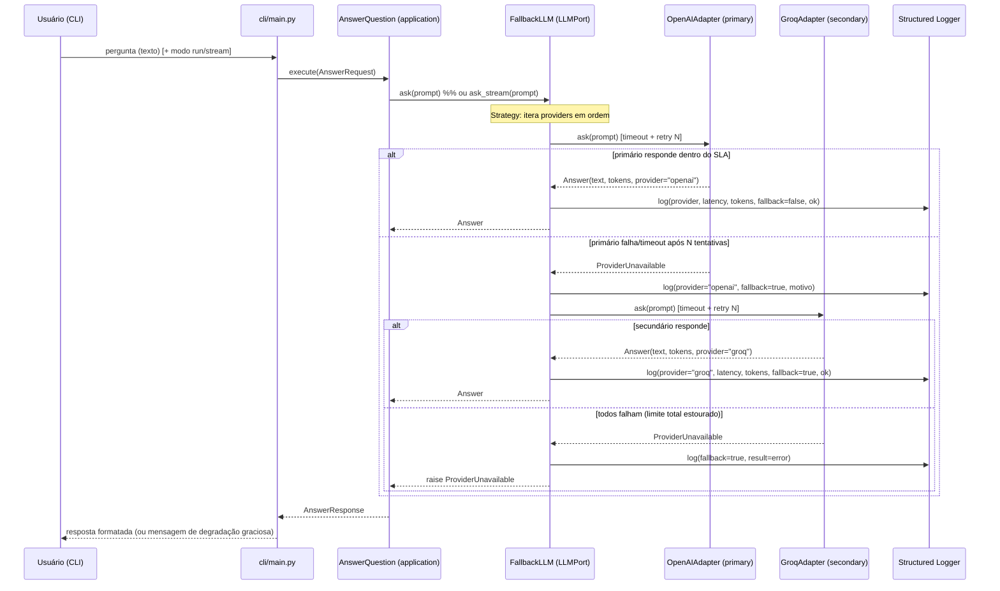

# Design Document: Agente 01 — Suporte com SLA e Fallback de Provider

> Documento de design técnico. Combina **High-Level Design** (arquitetura, diagramas,
> componentes, modelos de dados) e **Low-Level Design** (interfaces, algoritmos,
> assinaturas de função com especificações formais). Ler junto ao contrato de escopo
> (`.kiro/skills/agno-project-charter/agents/01-suporte-sla-fallback.md`) e ao charter
> (`.kiro/skills/agno-project-charter/SKILL.md`).
>
> Padrão de código: **Python 3.9+ / Agno v2** (linguagem explícita no escopo, seção 6).

---

## Overview

O Agente 01 é um assistente de suporte de primeiro nível que responde dúvidas de
clientes fundamentadas na documentação do produto. O objetivo de estudo é dominar o
agente Agno básico (persona, `instructions`, `run` vs `stream`, sampling) e, ao mesmo
tempo, torná-lo **resiliente**: múltiplos providers de LLM atrás de uma única `LLMPort`,
com **timeout, retry, fallback automático e degradação graciosa**.

A decisão arquitetural central — e o principal material de estudo — é que **o caso de
uso não sabe que existe fallback**. Para a camada de aplicação existe apenas uma
`LLMPort`. O fallback é um adapter de infraestrutura que implementa essa mesma port e,
por dentro, tenta vários providers em sequência. Esse arranjo é a aplicação prática de
dois princípios SOLID (Aberto/Fechado e Inversão de Dependência) e de dois padrões de
projeto (Composite + Strategy).

O sistema é entregue como **CLI + função chamável**. Fora de escopo: RAG, memória entre
sessões, deploy em nuvem e GUI (esses conceitos pertencem a agentes posteriores do
portfólio). A documentação da explicação de desenvolvimento (`DESENVOLVIMENTO.md`)
detalhará por que o fallback vive na infraestrutura, não no caso de uso.

---

## Architecture

### Camadas (ports & adapters)

A dependência aponta sempre para dentro: `interface` → `application` → `domain`. A
`infrastructure` implementa as ports definidas pelo domínio (inversão de dependência).
Tipos da Agno nunca vazam para fora de `infrastructure`.



Regra de ouro: `domain/` não importa nada de `infrastructure` nem de frameworks. O
`composition_root.py` é o único lugar que conhece implementações concretas. A camada
`interface/api` (FastAPI) depende apenas do caso de uso e dos DTOs, nunca de tipos da
Agno; tipos da Agno seguem confinados a `infrastructure/` e `agentos/`. A observabilidade
(OTel + `configure_agno_logging`) é ligada só em `infrastructure/composition_root`.

### Providers de LLM (incluindo fallback local)

Além de `OpenAIAdapter` e `GroqAdapter`, o `OllamaAdapter` implementa a mesma `LLMPort` e
envolve um `Agent` da Agno com o modelo Ollama — servindo como provider de **fallback
local** (custo zero, sem rede externa) no ambiente `docker-compose`. Como todos são
apenas mais uma `LLMPort` na lista do `FallbackLLM`, o **mesmo Composite + Strategy** vale:
acrescentar Ollama à `provider_order` (ex.: `openai,ollama`) não toca em domínio nem em
caso de uso (OCP). O endpoint do Ollama vem de env (`OLLAMA_HOST`).

### Diretório alvo (projeto isolado)

Projeto isolado em `agents/01-suporte-sla-fallback/` com `pyproject.toml` e `.venv`
próprios (via `uv`), Python 3.9+, Agno v2. Nenhum import de outro agente.

```
agents/01-suporte-sla-fallback/
├── pyproject.toml
├── uv.lock
├── .env.example
├── .env.local.example              # endpoints locais do docker-compose (Req 15.6)
├── .gitignore                      # ignora .env e .env.local
├── README.md                       # doc obrigatória (charter §6)
├── DESENVOLVIMENTO.md              # doc obrigatória (charter §6)
├── docker-compose.yml              # LocalStack, Ollama, AgentOS, observabilidade (Req 15)
├── template.yaml                   # SAM: API Gateway + Lambda + Layer (deploy padrão, Req 14)
├── Dockerfile                      # caminho container + AWS Lambda Web Adapter (Req 14.5)
├── otel/
│   └── collector-config.yaml       # config do OTel Collector (perfil grafana)
├── grafana/
│   └── datasources.yaml            # Tempo/Loki/Prometheus provisionados no Grafana
├── localstack/
│   └── init/
│       └── 01-bootstrap.sh         # cria tabela DynamoDB + segredo (idempotente, Req 15.7/15.8)
├── agentos/
│   └── app.py                      # AgentOS (porta 7777) reusa composition_root (Req 15.4)
├── src/
│   └── suporte/
│       ├── __init__.py
│       ├── domain/
│       │   ├── __init__.py
│       │   ├── ports.py            # LLMPort, Answer
│       │   └── exceptions.py       # ProviderUnavailable, OutOfScopeQuestion
│       ├── application/
│       │   ├── __init__.py
│       │   ├── dto.py              # AnswerRequest, AnswerResponse
│       │   └── use_cases/
│       │       ├── __init__.py
│       │       └── answer_question.py   # AnswerQuestion (recebe LLMPort injetada)
│       ├── infrastructure/
│       │   ├── __init__.py
│       │   ├── config.py           # Settings (env: providers, timeouts, retries, endpoints)
│       │   ├── observability/
│       │   │   ├── __init__.py
│       │   │   ├── logging.py      # log estruturado por requisição (StructuredLogger)
│       │   │   └── tracing.py      # OTel init/exporter + configure_agno_logging + request_id (Req 16)
│       │   └── llm/
│       │       ├── __init__.py
│       │       ├── openai_adapter.py    # OpenAIAdapter (envolve Agno)
│       │       ├── groq_adapter.py      # GroqAdapter (envolve Agno)
│       │       ├── ollama_adapter.py    # OllamaAdapter (envolve Agno; fallback local, Req 15.1)
│       │       └── fallback_llm.py      # FallbackLLM (Composite+Strategy)
│       ├── interface/
│       │   ├── __init__.py
│       │   ├── cli/
│       │   │   ├── __init__.py
│       │   │   └── main.py         # CLI: lê pergunta, chama caso de uso, formata
│       │   └── api/
│       │       ├── __init__.py
│       │       ├── api.py          # FastAPI app: rotas /chat, /chat/stream, /health + Pydantic (Req 14)
│       │       └── main.py         # handler = Mangum(app) (deploy padrão, Req 14.5)
│       └── composition_root.py     # monta FallbackLLM([primary, secondary]) e injeta; liga observabilidade
└── tests/
    ├── domain/
    ├── application/
    │   └── test_answer_question.py     # usa fake da LLMPort (sem rede)
    ├── infrastructure/
    │   ├── test_fallback_llm.py        # timeout, retry, fallback (adapters fake)
    │   ├── test_no_agno_in_api.py      # estático: interface/api não importa Agno (Req 14.6)
    │   └── test_request_id_correlation.py  # mesmo request_id em log e span (Req 16.4)
    └── interface/
        └── test_api.py                 # TestClient FastAPI: validação, /health, erro->502 (Req 14)
```

### Fluxo de requisição (sequência)

Fluxo feliz e fluxo com fallback no mesmo diagrama. Note que `AnswerQuestion` fala com
uma `LLMPort` — ele não distingue `FallbackLLM` de um adapter simples.



### Decisões de arquitetura (por que assim)

- **Fallback na infraestrutura, não no caso de uso** — O caso de uso orquestra a regra
  de negócio ("responder pergunta fundamentada"). Resiliência de provider é um detalhe
  de infraestrutura. Colocar retry/fallback no caso de uso o acoplaria a "quantos
  providers existem", violando SRP e OCP. Mantendo-o atrás da `LLMPort`, o caso de uso
  permanece testável com um fake e ignorante de rede.
- **Composite + Strategy** — `FallbackLLM` é um *Composite*: implementa a `LLMPort` e é
  composto por uma lista de outras `LLMPort`. É também *Strategy*: cada adapter é uma
  estratégia de obtenção de resposta; o `FallbackLLM` escolhe a próxima estratégia
  quando a atual falha. Adicionar um terceiro provider = acrescentar um adapter à lista,
  sem tocar em caso de uso nem no domínio (OCP).
- **DIP** — Caso de uso depende da abstração `LLMPort`; a infraestrutura implementa. A
  ligação concreta acontece só no `composition_root`.
- **Domínio sem framework** — `Answer` e `LLMPort` são Python puro. A Agno só aparece
  dentro de `infrastructure/llm/*_adapter.py`, envolvida (nunca vazada).

### Deploy e ambiente local

A **mesma app FastAPI** (`interface/api/api.py`) roda em todos os cenários; só muda o
runner e o destino das variáveis de ambiente — o código do agente não muda entre local e
produção.

- **Local (dev)**: a app sobe direto com `uvicorn` (ou é "vestida" pelo AgentOS na porta
  7777 para acompanhamento de runs/traces). Os serviços de terceiros vêm do
  `docker-compose.yml`: LocalStack (AWS emulada), Ollama (provider local de fallback) e um
  backend de observabilidade selecionado por **perfil do Compose** — SigNoz (padrão) ou
  Grafana+Tempo+Loki+Prometheus (`--profile grafana`), com Langfuse opcional
  (`--profile langfuse`). Endpoints (`AWS_ENDPOINT_URL`, `OTEL_EXPORTER_OTLP_ENDPOINT`,
  `OLLAMA_HOST`) vêm de `.env.local` (a partir de `.env.local.example`).
- **Serverless (produção)**: a app é publicada **atrás do AWS API Gateway** por dois
  caminhos que rodam a app FastAPI idêntica:
  - **Mangum (padrão)** — `handler = Mangum(app)` em `interface/api/main.py`; deps pesadas
    (agno, fastapi, mangum, provider SDKs) num Lambda Layer; deploy via `template.yaml`
    (SAM).
  - **Container + AWS Lambda Web Adapter (alternativa)** — quando o pacote excede o limite
    de Lambda Layers (250 MB), a mesma app roda com `uvicorn` numa imagem de container
    (`Dockerfile`), com o Web Adapter fazendo a ponte HTTP↔Lambda (suporta streaming real).
- **Observabilidade trocada por env**: o destino do tracing OTel é definido por
  `OTEL_EXPORTER_OTLP_ENDPOINT`. Apontar para o collector local (SigNoz/Grafana) ou para a
  AWS (CloudWatch Logs + X-Ray via ADOT layer, `Tracing: Active` no SAM) é só mudar essa
  variável — **sem alterar código** do agente. O LocalStack permite ensaiar o deploy SAM
  antes da AWS real.

---

## Components and Interfaces

### Component: `domain/ports.py` — `LLMPort` e `Answer`

**Purpose**: Definir o contrato do qual a aplicação depende e o value object de saída.
Python puro, sem Agno.

**Interface**:
```python
from typing import Iterator, Protocol, runtime_checkable
from dataclasses import dataclass

@dataclass(frozen=True)
class Answer:
    """Value object imutável com a resposta e metadados de custo/observabilidade."""
    text: str            # texto da resposta ao usuário
    provider: str        # provider que efetivamente respondeu (ex.: "openai")
    prompt_tokens: int   # tokens de entrada consumidos
    completion_tokens: int  # tokens de saída consumidos
    latency_ms: float    # latência da chamada bem-sucedida (ms)
    out_of_scope: bool = False  # True quando o agente sinaliza "encaminhar a humano"

    @property
    def total_tokens(self) -> int:
        return self.prompt_tokens + self.completion_tokens

@runtime_checkable
class LLMPort(Protocol):
    """Contrato que a aplicação exige de qualquer provedor de LLM.
    Implementado por adapters concretos e pelo FallbackLLM (Composite)."""

    def ask(self, prompt: str) -> Answer:
        """Modo run: resposta completa. Levanta ProviderUnavailable se indisponível."""
        ...

    def ask_stream(self, prompt: str) -> Iterator[str]:
        """Modo stream: gera pedaços de texto incrementalmente."""
        ...
```

**Responsibilities**:
- Definir `LLMPort` (contrato mínimo: `ask`, `ask_stream`) — ISP: port pequena e focada.
- Definir `Answer` como value object imutável (`frozen=True`).

### Component: `domain/exceptions.py`

**Purpose**: Erros de domínio, traduzidos para mensagens amigáveis na `interface`.

**Interface**:
```python
class DomainError(Exception):
    """Base de erros de domínio."""

class ProviderUnavailable(DomainError):
    """Nenhum provider conseguiu responder dentro do SLA (após retry + fallback)."""
    def __init__(self, attempts: list[str], message: str = "Todos os providers falharam"):
        self.attempts = attempts  # nomes dos providers tentados, na ordem
        super().__init__(message)

class OutOfScopeQuestion(DomainError):
    """A pergunta está fora do escopo conhecido; deve ser encaminhada a um humano."""
```

**Responsibilities**: Sinalizar falha total de providers (RNF-02) e pergunta fora de
escopo (RF-03), sem vazar detalhes de framework.

### Component: `application/dto.py` — DTOs de entrada/saída

**Purpose**: Desacoplar a entrada da `interface` da assinatura interna do caso de uso.

**Interface**:
```python
from dataclasses import dataclass
from enum import Enum

class Mode(str, Enum):
    RUN = "run"
    STREAM = "stream"

@dataclass(frozen=True)
class AnswerRequest:
    question: str
    mode: Mode = Mode.RUN

@dataclass(frozen=True)
class AnswerResponse:
    text: str
    provider: str
    total_tokens: int
    latency_ms: float
    used_fallback: bool
    out_of_scope: bool
    escalated: bool          # True quando encaminhado a humano ou degradação graciosa
```

### Component: `application/use_cases/answer_question.py` — `AnswerQuestion`

**Purpose**: Orquestra a regra de negócio. **Não conhece fallback** — depende só de
`LLMPort`.

**Interface**:
```python
from typing import Iterator
from suporte.domain.ports import LLMPort, Answer
from suporte.domain.exceptions import ProviderUnavailable, OutOfScopeQuestion
from suporte.application.dto import AnswerRequest, AnswerResponse

class AnswerQuestion:
    def __init__(self, llm: LLMPort) -> None:  # DIP: recebe abstração injetada
        self._llm = llm

    def execute(self, request: AnswerRequest) -> AnswerResponse: ...

    def execute_stream(self, question: str) -> Iterator[str]: ...
```

**Responsibilities**:
- Validar a pergunta (não vazia).
- Chamar `LLMPort.ask` / `ask_stream`.
- Traduzir `Answer` → `AnswerResponse`.
- Tratar `OutOfScopeQuestion` (RF-03) e `ProviderUnavailable` → degradação graciosa
  (RNF-02) sem stacktrace vazado.

### Component: `infrastructure/config.py` — `Settings`

**Purpose**: Ler configuração de ambiente (RNF-04). Nenhuma chave hardcoded.

**Interface**:
```python
from dataclasses import dataclass, field

@dataclass(frozen=True)
class ProviderConfig:
    name: str            # "openai" | "groq" | "ollama"
    model_id: str        # ex.: "gpt-4o-mini", "llama-3.3-70b-versatile"
    api_key_env: str     # nome da variável de env (nunca o valor no código)

@dataclass(frozen=True)
class Settings:
    provider_order: list[str]         # ordem de fallback, ex.: ["openai", "groq"]
    providers: dict[str, ProviderConfig]
    per_attempt_timeout_s: float = 10.0   # RNF-01
    total_timeout_s: float = 25.0         # RNF-01 (limite superior total)
    max_attempts_per_provider: int = 2    # RNF-02
    backoff_base_s: float = 0.5           # RNF-02 (backoff exponencial)

def load_settings() -> Settings:
    """Lê env via os.getenv + python-dotenv. Ex.:
    MODEL_PROVIDER_ORDER=openai,groq  → provider_order
    LLM_PER_ATTEMPT_TIMEOUT=10        → per_attempt_timeout_s
    LLM_MAX_ATTEMPTS=2                → max_attempts_per_provider
    """
    ...
```

**Responsibilities**: Traduzir env em `Settings` tipado (RF-04: trocar provider por env,
sem mudar código de domínio).

### Component: `infrastructure/llm/openai_adapter.py` / `groq_adapter.py`

**Purpose**: Envolver o `Agent` da Agno e implementar `LLMPort`. Único lugar onde tipos
Agno existem.

**Interface**:
```python
from typing import Iterator
from suporte.domain.ports import LLMPort, Answer

class OpenAIAdapter:  # implementa LLMPort (Protocol)
    def __init__(self, model_id: str, instructions: list[str], product_context: dict):
        # importa agno AQUI dentro; monta agno.agent.Agent com OpenAIChat(id=model_id)
        ...
    def ask(self, prompt: str) -> Answer: ...
    def ask_stream(self, prompt: str) -> Iterator[str]: ...
```

`GroqAdapter` é análogo, usando `agno.models.groq.Groq`. Ambos:
- Injetam a documentação do produto via `instructions` + `context` (RF-01, sem RAG).
- Convertem a resposta da Agno em `Answer` (extraindo tokens e provider).
- Detectam sinal de "fora de escopo" na resposta e marcam `out_of_scope=True` (RF-03).
- Traduzem falhas de rede/timeout em `ProviderUnavailable` (LSP: mesmo contrato de erro).

### Component: `infrastructure/llm/fallback_llm.py` — `FallbackLLM`

**Purpose**: Composite que implementa `LLMPort` e, por dentro, aplica timeout + retry +
fallback + log. **Coração da resiliência.**

**Interface**:
```python
from typing import Iterator, Sequence
from suporte.domain.ports import LLMPort, Answer

class FallbackLLM:  # implementa LLMPort
    def __init__(
        self,
        providers: Sequence[LLMPort],       # [primary, secondary, ...] — Composite
        per_attempt_timeout_s: float,
        total_timeout_s: float,
        max_attempts_per_provider: int,
        backoff_base_s: float,
        logger,                              # structured logger (observability)
        clock=time.monotonic,                # injetável para teste
    ) -> None: ...

    def ask(self, prompt: str) -> Answer: ...
    def ask_stream(self, prompt: str) -> Iterator[str]: ...
```

**Responsibilities**:
- Iterar providers na ordem (Strategy).
- Por provider: retry com backoff até `max_attempts_per_provider` (RNF-02).
- Aplicar timeout por tentativa (RNF-01) e respeitar limite total (RNF-01).
- Se um provider esgota tentativas, passar ao próximo (fallback) e logar o evento
  (RF-05).
- Se todos falharem, levantar `ProviderUnavailable` (RNF-02).
- Emitir log estruturado por requisição (RNF-03, RNF-05).

### Component: `infrastructure/observability/logging.py`

**Purpose**: Log estruturado (JSON) por requisição para análise de custo e observabilidade.

**Interface**:
```python
def log_request(
    *, question_hash: str, provider: str, latency_ms: float,
    prompt_tokens: int, completion_tokens: int, used_fallback: bool,
    attempts: list[str], result: str,   # "ok" | "error"
) -> None: ...
```

**Responsibilities**: Registrar pergunta (hash, para não vazar PII), provider, latência,
tokens, se houve fallback e resultado (RNF-03, RNF-05). Nunca loga a chave de API.

### Component: `interface/cli/main.py`

**Purpose**: Ponto de entrada fino. Lê a pergunta, escolhe modo, chama o caso de uso via
`composition_root`, formata a saída. Traduz erros de domínio em mensagens amigáveis.

### Component: `composition_root.py`

**Purpose**: Único lugar que conhece classes concretas. Monta
`FallbackLLM([primary, secondary])` a partir de `Settings` e injeta em `AnswerQuestion`.

**Interface**:
```python
from suporte.application.use_cases.answer_question import AnswerQuestion

def build_answer_question() -> AnswerQuestion:
    settings = load_settings()
    init_tracing(settings.otel_endpoint)   # liga OTel + configure_agno_logging (Req 16.1/16.3/16.8)
    adapters = [build_adapter(settings.providers[name]) for name in settings.provider_order]
    fallback = FallbackLLM(adapters, ...settings..., logger=...)
    return AnswerQuestion(llm=fallback)   # caso de uso só vê uma LLMPort

def build_agent_for_agentos():
    """Devolve o Agent Agno já configurado para o AgentOS 'vestir' (Req 15.4).
    Reusa a mesma montagem de adapter/observabilidade; não duplica domínio."""
    ...
```

**Responsibilities**: único ponto que conhece o concreto. Além de montar
`FallbackLLM`/`AnswerQuestion`, é o único lugar que **liga a observabilidade**
(`init_tracing` + `configure_agno_logging`) — nunca o domínio nem o caso de uso (Req 16.8).
Expõe `build_agent_for_agentos` para o AgentOS reaproveitar a mesma montagem.

### Component: `interface/api/api.py` — app FastAPI

**Purpose**: Expor o agente por HTTP como aplicação **FastAPI** (rotas + validação
Pydantic + docs OpenAPI), reutilizando `AnswerQuestion` via `composition_root`. Depende só
do caso de uso e dos DTOs — **nunca de tipos da Agno** (Req 14.1, 14.6).

**Interface**:
```python
from fastapi import FastAPI, HTTPException
from pydantic import BaseModel, Field
from fastapi.responses import StreamingResponse

from suporte.composition_root import build_answer_question
from suporte.application.dto import AnswerRequest, AnswerResponse, Mode
from suporte.domain.exceptions import DomainError

# use case montado UMA vez por processo/container (reuso entre invocações)
_use_case = build_answer_question()

app = FastAPI(title="Agente 01 — Suporte SLA/Fallback", version="1.0.0")  # /docs (Req 14.9)


class ChatIn(BaseModel):
    question: str = Field(min_length=1, max_length=4000)   # 1..4000 (Req 14.2/14.3)
    mode: Mode = Mode.RUN                                   # conjunto finito do domínio


class ChatOut(BaseModel):
    text: str
    provider: str
    total_tokens: int
    latency_ms: float
    used_fallback: bool
    out_of_scope: bool
    escalated: bool


@app.get("/health")                                        # Req 14.8
def health() -> dict:
    return {"status": "ok"}


@app.post("/chat", response_model=ChatOut)                 # Req 14.2
def chat(body: ChatIn) -> ChatOut:
    try:
        resp: AnswerResponse = _use_case.execute(AnswerRequest(body.question, body.mode))
    except DomainError:                                    # erro de domínio -> 502 (Req 14.7)
        raise HTTPException(status_code=502, detail="falha ao processar a solicitação")
    return ChatOut(**resp.__dict__)


@app.post("/chat/stream")                                  # streaming (container/Web Adapter)
def chat_stream(body: ChatIn) -> StreamingResponse:
    def gen():
        yield from _use_case.execute_stream(body.question)
    return StreamingResponse(gen(), media_type="text/plain")
```

**Responsibilities**:
- Validar a entrada na borda com Pydantic: `question` 1..4000 e `mode` no conjunto finito
  do domínio; corpo malformado ou fora do intervalo → erro de validação de cliente (422),
  **sem** invocar `AnswerQuestion` e **sem** stacktrace (Req 14.3).
- Traduzir erro de domínio em HTTP `502` sem vazar detalhes internos (Req 14.7).
- Expor `GET /health` (200) e docs OpenAPI (`/docs`) (Req 14.8, 14.9).
- Montar o caso de uso fora das rotas (uma vez por container) e nunca importar Agno.

### Component: `interface/api/main.py` — handler Lambda (Mangum)

**Purpose**: Adaptar a app FastAPI ao evento do Lambda no caminho de deploy **padrão**.

**Interface**:
```python
from mangum import Mangum
from suporte.interface.api.api import app

handler = Mangum(app)   # API Gateway <-> ASGI (caminho padrão, Req 14.5)
```

No caminho **alternativo** (container + AWS Lambda Web Adapter), o `Dockerfile` sobe a
**mesma** `app` com `uvicorn` — sem Mangum — mantendo a app FastAPI idêntica (Req 14.5).

### Component: `infrastructure/llm/ollama_adapter.py` — `OllamaAdapter`

**Purpose**: Envolver um `Agent` da Agno com o modelo **Ollama** e implementar `LLMPort`.
Serve como provider de **fallback local** (custo zero, sem rede externa) no ambiente
`docker-compose` (Req 15.1). Tipos da Agno confinados aqui.

**Interface**:
```python
from typing import Iterator
from suporte.domain.ports import LLMPort, Answer

class OllamaAdapter:  # implementa LLMPort (Protocol)
    def __init__(self, model_id: str, host: str, instructions: list[str], product_context: dict):
        # importa agno AQUI dentro; monta Agent com agno.models.ollama.Ollama(id=model_id, host=host)
        # host vem de env (OLLAMA_HOST), nunca hardcoded (Req 15.5)
        ...
    def ask(self, prompt: str) -> Answer: ...
    def ask_stream(self, prompt: str) -> Iterator[str]: ...
```

**Responsibilities**: análogo a `OpenAIAdapter`/`GroqAdapter` — injeta a documentação via
`instructions`/`context` (sem RAG), converte a resposta da Agno em `Answer`, marca
`out_of_scope` e traduz falhas em `ProviderUnavailable` (LSP). Só mais uma `LLMPort` na
lista do `FallbackLLM` (mesmo Composite + Strategy).

### Component: `infrastructure/observability/tracing.py`

**Purpose**: Inicializar o tracing OpenTelemetry, ligar `configure_agno_logging` ao mesmo
logger JSON do `StructuredLogger` e oferecer helpers de `request_id`. Configurado **apenas
pelo `composition_root`** (Req 16.8).

**Interface**:
```python
import uuid
from typing import Optional

def init_tracing(otel_endpoint: Optional[str], *, debug_mode: bool = False) -> None:
    """Inicializa o exporter OTLP para `otel_endpoint` (OTEL_EXPORTER_OTLP_ENDPOINT).
    Se `otel_endpoint` for None/vazio: desabilita tracing, loga aviso e continua (Req 16.2).
    Chama configure_agno_logging(custom_default_logger=json_logger, ...) para o Agno
    emitir JSON de uma linha idêntico em estrutura ao StructuredLogger (Req 16.3).
    Liga debug_mode do Agno só em dev (Req 16.6); desligado por padrão (Req 16.7)."""
    ...

def new_request_id() -> str:
    """Gera um request_id único por requisição."""
    return uuid.uuid4().hex

def set_request_id_on_span(request_id: str) -> None:
    """Anexa o request_id como atributo no span OTel atual (app.request_id),
    idêntico ao campo registrado no log estruturado — correlaciona log e trace (Req 16.4)."""
    ...
```

**Responsibilities**:
- Configurar exporter OTLP a partir de env; endpoint ausente/vazio → tracing desabilitado
  + aviso, sem interromper a requisição (Req 16.2).
- Ligar `configure_agno_logging` ao logger JSON de uma linha (Req 16.3).
- Gerar `request_id` e gravá-lo **igual** no log e no span (Req 16.4).
- Garantir que pergunta apareça só como `question_hash` e nenhuma PII/chave vaze em log ou
  trace (Req 16.5).
- Habilitar `debug_mode` do Agno só em dev (Req 16.6/16.7).

### Component: `agentos/app.py` — AgentOS (dev)

**Purpose**: Superfície de **acompanhamento local** (runs, sessions, traces) na porta 7777.
"Veste" o mesmo agente montado pelo `composition_root`, sem duplicar domínio (Req 15.4).
Tipos da Agno confinados aqui (junto de `infrastructure`).

**Interface**:
```python
from agno.os import AgentOS
from suporte.composition_root import build_agent_for_agentos

agent = build_agent_for_agentos()          # reusa a montagem; não duplica domínio

agent_os = AgentOS(agents=[agent])         # tracing OTel via OTEL_EXPORTER_OTLP_ENDPOINT (env)
app = agent_os.get_app()                    # app FastAPI do AgentOS (porta 7777)
```

**Responsibilities**: ferramenta de desenvolvimento/acompanhamento local; o deploy de
produção usa a app FastAPI + API Gateway, não o AgentOS. O endpoint de tracing vem de env,
apontando para o collector local do `docker-compose`.

---

## Data Models

### Model: `Answer` (domain value object)

| Campo | Tipo | Regra de validação |
|-------|------|--------------------|
| `text` | `str` | Não vazio quando `out_of_scope=False` |
| `provider` | `str` | Um dos providers configurados |
| `prompt_tokens` | `int` | `>= 0` |
| `completion_tokens` | `int` | `>= 0` |
| `latency_ms` | `float` | `>= 0` |
| `out_of_scope` | `bool` | Default `False` |

Imutável (`frozen=True`). `total_tokens` é derivado.

### Model: `ProviderConfig` / `Settings`

| Campo | Tipo | Regra |
|-------|------|-------|
| `provider_order` | `list[str]` | ≥ 2 providers (premissa do escopo, §6) |
| `per_attempt_timeout_s` | `float` | `> 0`, default 10 (RNF-01) |
| `total_timeout_s` | `float` | `>= per_attempt_timeout_s` |
| `max_attempts_per_provider` | `int` | `>= 1`, default 2 (RNF-02) |
| `backoff_base_s` | `float` | `>= 0` |
| `ProviderConfig.api_key_env` | `str` | Nome da env var; valor lido em runtime (RNF-04) |

### Model: `AnswerRequest` / `AnswerResponse` (DTOs)

`AnswerRequest{ question: str, mode: Mode }`; `AnswerResponse` carrega metadados de
observabilidade (`provider`, `total_tokens`, `latency_ms`, `used_fallback`,
`out_of_scope`, `escalated`) para a `interface` renderizar e para conferência dos
critérios de aceite.

---

## Algorithmic Pseudocode

### Algoritmo principal: `FallbackLLM.ask`

```pascal
ALGORITHM FallbackLLM_ask(prompt)
INPUT: prompt: String
OUTPUT: answer: Answer
STATE: providers[] (ordenados), per_attempt_timeout, total_timeout,
       max_attempts, backoff_base, logger, clock

BEGIN
    ASSERT length(providers) >= 1
    ASSERT prompt <> ""

    start_time    ← clock()
    tried[]       ← empty list
    used_fallback ← false
    last_error    ← null

    // Strategy: percorre providers na ordem de preferência
    FOR each provider IN providers DO
        // primeiro provider da lista é o primário; demais são fallback
        IF length(tried) >= 1 THEN
            used_fallback ← true
        END IF
        tried.append(provider.name)

        attempt ← 0
        WHILE attempt < max_attempts DO
            ASSERT (clock() - start_time) < total_timeout   // limite total (RNF-01)

            remaining_total ← total_timeout - (clock() - start_time)
            deadline        ← MIN(per_attempt_timeout, remaining_total)

            attempt_start ← clock()
            TRY
                answer ← call_with_timeout(provider.ask, prompt, deadline)
                latency_ms ← (clock() - attempt_start) * 1000

                // log de sucesso (RNF-03, RNF-05)
                logger.log_request(
                    question_hash=hash(prompt), provider=provider.name,
                    latency_ms=latency_ms, prompt_tokens=answer.prompt_tokens,
                    completion_tokens=answer.completion_tokens,
                    used_fallback=used_fallback, attempts=tried, result="ok")

                RETURN answer WITH provider=provider.name, latency_ms=latency_ms
            CATCH TimeoutError OR ProviderCallError AS err
                last_error ← err
                attempt ← attempt + 1
                IF attempt < max_attempts THEN
                    // backoff exponencial antes de nova tentativa (RNF-02)
                    sleep(backoff_base * (2 ^ (attempt - 1)))
                END IF
            END TRY
        END WHILE
        // esgotou tentativas deste provider → loga evento de fallback (RF-05)
        logger.log_request(
            question_hash=hash(prompt), provider=provider.name, latency_ms=0,
            prompt_tokens=0, completion_tokens=0, used_fallback=true,
            attempts=tried, result="error")
    END FOR

    // todos os providers falharam → degradação graciosa a cargo do caso de uso
    RAISE ProviderUnavailable(attempts=tried)
END
```

**Preconditions**:
- `providers` contém ≥ 1 `LLMPort` válida; `prompt` não é vazio.
- `0 < per_attempt_timeout <= total_timeout`; `max_attempts >= 1`.

**Postconditions**:
- Retorna `Answer` do primeiro provider que responder dentro do SLA, com `provider` e
  `latency_ms` preenchidos, **ou** levanta `ProviderUnavailable(attempts)` listando os
  providers tentados na ordem.
- Emite exatamente um log de resultado por tentativa relevante (sucesso ou esgotamento).
- Nunca excede `total_timeout` sem levantar `ProviderUnavailable`.

**Loop Invariants**:
- Loop externo (`FOR provider`): `tried` contém exatamente os providers já iniciados, na
  ordem de preferência; `used_fallback` é `true` sse e somente se ≥ 1 provider anterior
  já foi tentado.
- Loop interno (`WHILE attempt`): `attempt` conta tentativas feitas neste provider;
  invariante de SLA `clock() - start_time < total_timeout` verificada a cada iteração.

### Algoritmo: `AnswerQuestion.execute` (degradação graciosa)

```pascal
ALGORITHM AnswerQuestion_execute(request)
INPUT: request: AnswerRequest
OUTPUT: response: AnswerResponse
STATE: llm: LLMPort   // pode ser FallbackLLM ou adapter simples — caso de uso não sabe

BEGIN
    // validação de entrada (regra de aplicação)
    IF request.question IS NULL OR trim(request.question) = "" THEN
        RETURN AnswerResponse(text="Envie uma pergunta válida.", escalated=false, ...)
    END IF

    TRY
        answer ← llm.ask(request.question)      // não sabe de fallback (DIP)

        IF answer.out_of_scope = true THEN
            // RF-03: encaminhar a humano, sem alucinar
            RETURN AnswerResponse(
                text="Não tenho essa informação na documentação. Vou encaminhar "
                     "sua pergunta para um atendente humano.",
                provider=answer.provider, out_of_scope=true, escalated=true, ...)
        END IF

        RETURN AnswerResponse(
            text=answer.text, provider=answer.provider,
            total_tokens=answer.total_tokens, latency_ms=answer.latency_ms,
            used_fallback=(answer.provider <> primary_provider_name),
            out_of_scope=false, escalated=false)

    CATCH ProviderUnavailable AS err
        // RNF-02: degradação graciosa — mensagem clara, sem stacktrace
        RETURN AnswerResponse(
            text="Nosso assistente está indisponível no momento. "
                 "Sua pergunta será encaminhada para um atendente humano.",
            provider="none", escalated=true, ...)
    END TRY
END
```

**Preconditions**: `llm` implementa `LLMPort`; `request` é um `AnswerRequest`.

**Postconditions**:
- Sempre retorna um `AnswerResponse` (nunca propaga exceção ao chamador da CLI).
- Pergunta vazia → resposta de validação, `escalated=false`.
- `out_of_scope` ou `ProviderUnavailable` → `escalated=true` com mensagem amigável.

**Loop Invariants**: N/A (sem laços).

### Algoritmo: `call_with_timeout` (mecanismo de deadline por tentativa)

```pascal
ALGORITHM call_with_timeout(fn, prompt, deadline_s)
INPUT: fn (provider.ask), prompt, deadline_s
OUTPUT: Answer  (ou levanta TimeoutError)

BEGIN
    future ← run_in_worker(fn, prompt)      // executor com thread/processo
    result ← future.wait(timeout=deadline_s)
    IF result = TIMED_OUT THEN
        future.cancel()
        RAISE TimeoutError
    END IF
    RETURN result
END
```

**Preconditions**: `deadline_s > 0`. **Postconditions**: retorna `Answer` se `fn`
concluir dentro de `deadline_s`; caso contrário levanta `TimeoutError` sem bloquear além
do prazo. **Nota de implementação**: usar `concurrent.futures.ThreadPoolExecutor` +
`future.result(timeout=deadline_s)`; o SDK do provider também recebe seu próprio timeout
de rede como defesa em profundidade.

---

## Key Functions with Formal Specifications

### `LLMPort.ask(prompt: str) -> Answer`

**Preconditions**: `prompt` é string não vazia.
**Postconditions**: retorna `Answer` válido (`text` não vazio se `out_of_scope=False`),
ou levanta `ProviderUnavailable`. Sem efeitos colaterais no domínio.
**Loop Invariants**: N/A.

### `LLMPort.ask_stream(prompt: str) -> Iterator[str]`

**Preconditions**: `prompt` não vazio.
**Postconditions**: produz uma sequência de fragmentos de texto cuja concatenação
equivale, em conteúdo, ao `text` que `ask` retornaria para o mesmo prompt (LSP:
consistência entre modos). Levanta `ProviderUnavailable` se o provider indisponível.

### `OpenAIAdapter.ask(prompt) -> Answer` (e `GroqAdapter.ask`)

**Preconditions**: `prompt` não vazio; env var da chave presente no ambiente.
**Postconditions**: converte a resposta da Agno em `Answer` com `provider`, tokens e
latência; marca `out_of_scope=True` quando o modelo sinaliza falta de fundamentação;
traduz falha de rede/timeout em `ProviderUnavailable` (mesmo contrato — LSP).
**Loop Invariants**: N/A.

### `load_settings() -> Settings`

**Preconditions**: variáveis de ambiente carregadas (`.env` via `python-dotenv`).
**Postconditions**: retorna `Settings` com `provider_order` de ≥ 1 nome válido e defaults
aplicados (timeout 10s, 2 tentativas). Levanta `ValueError` se um provider referenciado
não tiver `ProviderConfig`. Nenhum valor de chave é retornado, apenas o nome da env var.
**Loop Invariants**: para o parse da lista de providers, todos os itens já processados
são nomes conhecidos.

---

## Example Usage

```python
# --- Como a interface usa o caso de uso (modo run) ---
from suporte.composition_root import build_answer_question
from suporte.application.dto import AnswerRequest, Mode

use_case = build_answer_question()   # monta FallbackLLM([openai, groq]) e injeta

resp = use_case.execute(AnswerRequest(question="Como redefino minha senha?"))
print(resp.text)
print(f"[provider={resp.provider} tokens={resp.total_tokens} "
      f"latencia={resp.latency_ms:.0f}ms fallback={resp.used_fallback}]")

# --- Modo stream (melhor UX; RF-02) ---
for chunk in use_case.execute_stream("Explique o limite de transferência diária."):
    print(chunk, end="", flush=True)

# --- Pergunta fora de escopo (RF-03): encaminha a humano, não inventa ---
out = use_case.execute(AnswerRequest(question="Qual é a capital da Mongólia?"))
assert out.escalated is True and out.out_of_scope is True

# --- Trocar provider primário por env (RF-04), sem mudar código ---
#   MODEL_PROVIDER_ORDER=groq,openai  → Groq vira primário no próximo run
```

```python
# --- Montagem do FallbackLLM no composition_root (Composite + Strategy) ---
fallback = FallbackLLM(
    providers=[openai_adapter, groq_adapter],   # ordem = preferência
    per_attempt_timeout_s=settings.per_attempt_timeout_s,   # 10s (RNF-01)
    total_timeout_s=settings.total_timeout_s,               # limite superior
    max_attempts_per_provider=settings.max_attempts_per_provider,  # 2 (RNF-02)
    backoff_base_s=settings.backoff_base_s,
    logger=structured_logger,
)
answer_question = AnswerQuestion(llm=fallback)   # o caso de uso só vê uma LLMPort
```

---

## Correctness Properties

Propriedades verificáveis (base para testes de propriedade e de exemplo). Notação de
quantificação universal sobre entradas válidas.

### Property 1: Ordem de fallback

∀ lista de providers `[p1, p2, ..., pn]`, se `p1` responde dentro do SLA então `ask`
retorna a resposta de `p1` e `used_fallback = false`. (RF-05, RNF-02)

**Validates: Requirements 5.1**

### Property 2: Fallback automático

∀ prompt, se `p1` falha em todas as `max_attempts` tentativas e `p2` responde, então
`ask` retorna a resposta de `p2`, `provider = p2` e um evento de fallback é logado. (RF-05)

**Validates: Requirements 5.2, 5.3, 5.4**

### Property 3: Degradação graciosa

∀ prompt, se todos os providers falham, `AnswerQuestion.execute` retorna
`escalated = true` com mensagem clara e **não** propaga exceção nem stacktrace. (RNF-02)

**Validates: Requirements 7.5**

### Property 4: SLA total

∀ execução, o tempo total até retornar/levantar `ProviderUnavailable` ≤ `total_timeout_s`
+ margem de uma verificação. (RNF-01)

**Validates: Requirements 6.5**

### Property 5: Sem alucinação fora de escopo

∀ pergunta marcada `out_of_scope`, a resposta ao usuário é a mensagem de encaminhamento,
nunca conteúdo inventado. (RF-03)

**Validates: Requirements 3.2, 3.3**

### Property 6: Isolamento do domínio

`domain/` e `application/` não importam Agno nem SDKs de provider (verificável por
inspeção estática de imports). (Arquitetura / DIP)

**Validates: Requirements 12.5, 12.6**

### Property 7: Consistência run/stream

∀ prompt, `"".join(ask_stream(prompt))` é consistente em conteúdo com `ask(prompt).text`
para o mesmo provider e sampling. (RF-02, LSP)

**Validates: Requirements 2.5**

### Property 8: Segredos fora do código

nenhum literal de chave de API aparece no código; chaves lidas só via env. `.env` no
`.gitignore`; `.env.example` presente. (RNF-04)

**Validates: Requirements 10.1, 10.3, 10.4**

### Property 9: Observabilidade completa

∀ requisição bem-sucedida ou falha, existe um log estruturado com `provider`, `latency`,
`tokens`, `used_fallback` e `result`. (RNF-03, RNF-05)

**Validates: Requirements 9.1**

### Property 10: FastAPI reutiliza o domínio, sem tipos Agno, erro → 502

A camada `interface/api` reutiliza `AnswerQuestion` via `composition_root` e **não importa
tipos da Agno** (verificável por inspeção estática de imports). ∀ requisição a `POST /chat`
em que o processamento resulta em erro de domínio (`DomainError`), a API responde HTTP
`502` com mensagem genérica, sem stacktrace nem detalhes internos.

**Validates: Requirements 14.1, 14.6, 14.7**

### Property 11: Mesma app FastAPI nos dois deploys, com validação na borda

A **mesma** app FastAPI é publicada nos dois caminhos de deploy (Mangum e container + AWS
Lambda Web Adapter). ∀ requisição a `POST /chat`, a app valida a entrada na borda —
`question` com comprimento em `[1, 4000]` e `mode` no conjunto finito de modos suportados —
**antes** de invocar `AnswerQuestion`; entrada fora do intervalo, modo inválido ou corpo
malformado → erro de validação de cliente sem invocar o caso de uso.

**Validates: Requirements 14.2, 14.3, 14.5**

### Property 12: Endpoints por env; observabilidade só na infraestrutura

∀ endpoint de serviço (AWS via `AWS_ENDPOINT_URL`, OTLP via `OTEL_EXPORTER_OTLP_ENDPOINT`,
Ollama via `OLLAMA_HOST`), o valor vem de variável de ambiente. Trocar
`OTEL_EXPORTER_OTLP_ENDPOINT` (collector local ↔ AWS) ou o backend de observabilidade
**não altera o código do agente**, e toda configuração de observabilidade reside apenas em
`infrastructure`/`composition_root` (verificável: `domain`/`application` não referenciam
tracing, `configure_agno_logging` nem exporter OTLP).

**Validates: Requirements 15.5, 16.1, 16.8**

### Property 13: Correlação request_id e ausência de PII

∀ requisição, existe um `request_id` único registrado de forma **idêntica** no log
estruturado (campo) e no span OpenTelemetry (atributo `app.request_id`), permitindo
correlacionar log e trace pelo mesmo valor. ∀ log e ∀ span, nenhuma PII, texto de pergunta
em claro ou chave de API aparece — a pergunta consta somente como `question_hash`.

**Validates: Requirements 16.3, 16.4, 16.5**

### Property 14: Eficácia e eficiência avaliadas por taxa e orçamento

∀ execução do golden set, a eficácia é agregada por **taxa** (acurácia geral e
`out_of_scope recall`) comparada a um threshold, nunca por pass/fail de caso individual, com
o threshold de `out_of_scope recall` estritamente maior que o da acurácia geral. ∀ conjunto
de requisições avaliadas, a eficiência operacional é derivada apenas do log estruturado
(`latency_ms`, tokens, `used_fallback`), a latência é asserida por percentil (p95/p99),
nunca por média nem máximo, e nenhuma latência registrada excede `total_timeout_s`.

**Validates: Requirements 17.5, 17.6, 17.8, 17.10**

---

## Error Handling

### Cenário 1: Timeout do provider primário
**Condição**: `p1.ask` excede `per_attempt_timeout_s`.
**Resposta**: `call_with_timeout` levanta `TimeoutError`; `FallbackLLM` conta a tentativa,
aplica backoff e reexecuta até `max_attempts`.
**Recuperação**: esgotadas as tentativas, passa ao próximo provider (fallback) e loga.

### Cenário 2: Chave inválida / provider indisponível
**Condição**: adapter recebe erro de autenticação/rede do SDK.
**Resposta**: adapter traduz para `ProviderUnavailable` (LSP: mesmo contrato de erro).
**Recuperação**: `FallbackLLM` trata como falha da tentativa → fallback.

### Cenário 3: Todos os providers falham
**Condição**: nenhum provider responde dentro do `total_timeout_s`.
**Resposta**: `FallbackLLM` levanta `ProviderUnavailable(attempts)`.
**Recuperação**: `AnswerQuestion.execute` captura e retorna degradação graciosa (RNF-02).

### Cenário 4: Pergunta fora de escopo
**Condição**: modelo sinaliza falta de fundamentação na documentação.
**Resposta**: adapter marca `Answer.out_of_scope=True`.
**Recuperação**: caso de uso responde com encaminhamento a humano (RF-03).

### Cenário 5: Pergunta vazia/inválida
**Condição**: `request.question` vazia.
**Resposta**: caso de uso retorna mensagem de validação sem chamar o LLM (economia de
custo).
**Recuperação**: usuário reenvia pergunta.

### Cenário 6: `OTEL_EXPORTER_OTLP_ENDPOINT` ausente/vazio
**Condição**: a variável `OTEL_EXPORTER_OTLP_ENDPOINT` não está definida ou está vazia.
**Resposta**: `init_tracing` **desabilita** a exportação de tracing e registra no log
estruturado uma entrada de nível de **aviso** ("tracing desabilitado: endpoint não
configurado").
**Recuperação**: o processamento da requisição **continua normalmente** sem tracing; o log
estruturado segue funcionando (Req 16.2).

### Cenário 7: Erro de domínio em rota FastAPI
**Condição**: `AnswerQuestion` levanta `DomainError` durante o processamento de `POST /chat`.
**Resposta**: a rota traduz para `HTTPException(status_code=502, ...)` com mensagem
genérica de falha de processamento, **sem stacktrace nem detalhes internos**, preservando o
comportamento sem estado da requisição (Req 14.7).
**Recuperação**: cliente pode reenviar; detalhes ficam só no log (CloudWatch em produção).

### Cenário 8: Perfis SigNoz e Grafana ativados simultaneamente
**Condição**: os perfis padrão (SigNoz) e alternativo (Grafana+Tempo+Loki+Prometheus) do
`docker-compose` são ativados ao mesmo tempo.
**Resposta**: ambos tentam ocupar a mesma porta OTLP (4317/4318) → **conflito de porta**,
sinalizado pelo Compose, garantindo que apenas um backend de tracing OTLP ocupe a porta por
vez (Req 15.3).
**Recuperação**: ativar apenas um backend de observabilidade por vez (SigNoz **ou** Grafana);
Langfuse pode subir junto de qualquer um.

### Cenário 9: Bootstrap do LocalStack reexecutado
**Condição**: `localstack/init/01-bootstrap.sh` roda de novo com a tabela DynamoDB e o
segredo já existentes.
**Resposta**: o script conclui de forma **idempotente** (trata "recurso já existe" como
sucesso), sem falhar (Req 15.8).
**Recuperação**: N/A — reexecução é segura por design.

Regra transversal: erros de domínio nascem em `domain/exceptions.py` e são traduzidos
para mensagens amigáveis na `interface/cli` e em HTTP `502` na `interface/api`. Nenhum
stacktrace é exibido ao usuário final nem ao cliente HTTP.

---

## Testing Strategy

Derivada da skill `agno-testing-strategy`. A estratégia separa a "eficiência" do agente em
três sentidos — **operacional** (latência, tokens, taxa de fallback), **eficácia**
(qualidade da resposta) e **resiliência** (SLA sob falha) — e organiza os testes em três
camadas de e2e. Regra de ouro: **o LLM real fica fora do caminho determinístico**; a maior
parte da suíte usa fakes da `LLMPort`.

### As três camadas de e2e (Req 17.1)

- **Camada 1 — Transporte determinístico (gate de PR).** Caminho completo
  (HTTP → `AnswerQuestion` → `FallbackLLM` → adapter) com provider LLM fake. Valida
  contrato, status codes, ordem de fallback, timeout, backoff, degradação graciosa,
  observabilidade e isolamento de arquitetura. Rápido, sem rede. É o gate obrigatório.
- **Camada 2 — Comportamento do agente (nightly/pré-release).** Eval de eficácia com LLM
  real ou Ollama sobre o golden set (ver abaixo). Marcado `e2e`; não bloqueia PR.
- **Camada 3 — Sistema real (pré-release).** Smoke test contra o API Gateway + Lambda
  publicado ou LocalStack. Marcado `system`.

### Fakes reutilizáveis (Req 17.2) — `tests/fakes/`

- `FakeLLM`: retorna um `Answer` fixo (ou `out_of_scope=True`), base da camada 1.
- `ProgrammableAdapter`: falha um número configurável de vezes antes de responder (ou
  falha sempre) e conta chamadas — exercita fallback determinístico.
- `FakeClock`: relógio controlável (`advance(seconds)`), compatível com `clock=time.monotonic`,
  para testar timeout/backoff/SLA sem `sleep` real (Req 17.3).

### Unit Testing
- **Domínio/Aplicação sem rede**: testar `AnswerQuestion` com um `FakeLLM` que implementa
  `LLMPort` (retorna `Answer` fixo, ou levanta `ProviderUnavailable`/`OutOfScopeQuestion`).
  Cobre P3, P5 e validação de entrada.
- **`FallbackLLM` com adapters fake**: injetar providers fake determinísticos
  (`AlwaysFails`, `SlowProvider`, `AlwaysOk`) e um `clock` injetado para simular tempo.
  Cobre P1, P2, P4 e o backoff — sem chamar rede.

### Property-Based Testing
- **Biblioteca**: `hypothesis` (Python).
- **Propriedades**: P1/P2 (ordem e fallback com listas geradas de providers com padrões
  de falha variados), P4 (SLA total nunca excedido com `clock` simulado), P7 (consistência
  run/stream com um provider fake que gera texto por chunks).

### Integration / Smoke Testing
- Smoke test do `run` com provider real (marcado, requer chave) — não roda no CI padrão.
- Roteiro manual de aceite (seção 9 do escopo): pergunta conhecida, `run` e `stream`,
  pergunta fora de escopo, derrubar o primário (chave inválida/timeout forçado) e
  conferir log de fallback, inspecionar log estruturado (provider/latência/tokens).

### Verificação estática (P6, P8, P10, P12)
- Teste que varre `domain/` e `application/` proibindo imports de `agno`, `openai`, `groq`.
- Teste que garante ausência de literais de chave e presença de `.env.example` +
  `.env` no `.gitignore`.
- **Teste estático de que `interface/api` não importa tipos da Agno** (P10, Req 14.6):
  varre os módulos de `interface/api/` e falha se algum importar `agno`.
- Teste que garante que `domain/` e `application/` não referenciam tracing,
  `configure_agno_logging` nem exporter OTLP — observabilidade só em
  `infrastructure`/`composition_root` (P12, Req 16.8).

### FastAPI (rotas, sem rede) — P10, P11
- **`TestClient` do FastAPI** exercitando as rotas sem rede real (caso de uso montado com
  uma `LLMPort` fake via override do `composition_root`):
  - `POST /chat` com `question` de comprimento 0, 4001 e um `mode` inválido → erro de
    validação de cliente (422), sem invocar o caso de uso (Req 14.3, P11).
  - `POST /chat` válido → `ChatOut` com os metadados esperados.
  - `GET /health` → status `200` (Req 14.8).
  - Caso de uso fake que levanta `DomainError` → resposta HTTP `502` sem stacktrace
    (Req 14.7, P10).
  - `GET /docs`/`/openapi.json` acessível (Req 14.9).

### Correlação request_id (log ↔ trace) — P13
- Teste que injeta um **exporter OTel fake/in-memory** e um handler de log em memória,
  executa uma requisição e verifica que o **mesmo `request_id`** aparece como campo no log
  estruturado e como atributo `app.request_id` no span exportado (Req 16.4, P13); verifica
  também que nenhum texto de pergunta em claro nem chave de API aparece em log ou span
  (Req 16.5), apenas `question_hash`.
- Teste de que, com `OTEL_EXPORTER_OTLP_ENDPOINT` ausente/vazio, `init_tracing` desabilita
  o tracing, emite log de aviso e não interrompe a requisição (Req 16.2).

### Eval de eficácia (camada 2, golden set) — P14, Req 17.4–17.7

Mede quão bem o agente acerta sobre um dataset curado — não por igualdade de string, mas
por taxa de acerto contra thresholds. Três peças, em `tests/eval/`:

- **Dataset versionado** (`tests/eval/dataset.jsonl`): ≥ 20 casos, cada um com `question`,
  `expects` (`in_scope`/`out_of_scope`) e, para `in_scope`, âncoras `must_mention`.
  Cobre in-scope fácil, in-scope difícil e out-of-scope que **deve** escalar (Req 17.4).
- **Scorers** (`tests/eval/scorers.py`): determinístico (grátis, sempre roda) verifica
  `escalated=True` nos casos `out_of_scope` e presença das âncoras `must_mention` nos
  `in_scope`; LLM-as-judge (opcional, caro) julga fundamentação como sinal agregado por
  taxa, nunca como gate por caso (Req 17.5, 17.7).
- **Agregação com threshold**: o gate é sobre a taxa. `test_acuracia_geral` exige
  acurácia ≥ threshold; `test_recall_out_of_scope` exige `escalated` ≥ threshold **mais
  alto** (alucinar onde devia escalar é o pior erro — Req 3, Req 17.6).

Roda com **Ollama** por padrão no CI (custo zero, sem rede externa) e com provider real só
em pré-release — trocar é só mudar `MODEL_PROVIDER_ORDER`, pois a `LLMPort` é a mesma
(Req 17.12). Ambiente de eval usa `temperature` baixa e thresholds com folga para não
reprovar por ruído (Req 17.14). Marcado `@pytest.mark.e2e`.

### Eficiência operacional (asserção sobre o log) — Req 17.8–17.10

Não instrumenta de novo: as métricas vêm do log estruturado por requisição (`latency_ms`,
tokens, `used_fallback`). Um lote do golden set é executado, os logs são capturados,
agregados e comparados a **orçamentos (budgets)** configuráveis:

- **Latência**: percentil (p95/p99), **nunca** média nem máximo (Req 17.8).
- **Tokens**: consumo médio por requisição ≤ orçamento (Req 17.9).
- **Taxa de fallback**: fração com `used_fallback=true` ≤ orçamento (Req 17.9).
- **SLA**: nenhuma requisição excede `total_timeout_s` (Req 17.10).

Para medir só o overhead da orquestração (sem o LLM), usa-se `FakeLLM`/`ProgrammableAdapter`
com `delay_s` conhecido; com LLM real, mede-se ponta a ponta aceitando variância.

### Camada 3 — Smoke do sistema real — Req 17.13

Smoke marcado `@pytest.mark.system` contra o deploy (LocalStack ou AWS via
`AGENT_BASE_URL`): `GET /health` → `200`; `POST /chat` → `200` ou `502` (sem depender de
resposta determinística do modelo). O handler Mangum também é testado invocando `handler`
com um evento API Gateway sintético, sem AWS. Reusa o bootstrap idempotente do LocalStack.

### Marcadores e pipeline de CI (Req 17.1, 17.11)

Marcadores `pytest` em `pyproject.toml`: `e2e` (comportamento com LLM real/Ollama),
`system` (deploy real), `integration` (providers reais, já previsto na tarefa 13.2).

- **Gate de PR** (rápido, determinístico): `pytest -m "not e2e and not system and not integration"`
  — camada 1 + resiliência + eficiência operacional com fake + observabilidade.
- **Nightly**: `pytest -m e2e` com Ollama — eval de eficácia + eficiência real.
- **Pré-release**: `-m e2e` com provider real + `-m system` contra LocalStack/AWS.

---

## Performance Considerations

- **SLA previsível**: timeout por tentativa (10s default) + limite total garantem cota de
  latência determinística mesmo com fallback (P4).
- **Backoff exponencial**: evita martelar um provider degradado; base configurável.
- **Custo controlado**: pergunta vazia curto-circuita sem chamar LLM; tokens logados por
  requisição para análise de custo (RNF-03).
- **Stream**: reduz *time-to-first-token* percebido na CLI (RF-02).
- **Orçamentos de eficiência verificáveis**: latência (p95), tokens/custo médio e taxa de
  fallback são asseridos como budgets sobre o log estruturado (Req 17.8–17.10, P14), de modo
  que regressões de desempenho ao trocar modelo, prompt ou `provider_order` são detectadas
  automaticamente em vez de observadas manualmente.

## Security Considerations

- **Segredos fora do código** (RNF-04): chaves só via env; `ProviderConfig` guarda o
  *nome* da env var, nunca o valor. `.env` no `.gitignore`; `.env.example` sem valores.
- **PII em logs**: a pergunta é logada como *hash* (ou truncada), não em claro, para
  reduzir exposição de dados do cliente (RNF-05).
- **Sem stacktrace ao usuário**: erros traduzidos em mensagens amigáveis (RNF-02).

## Dependencies

### Dependências Python (do projeto, via `uv`)
- **Runtime núcleo**: `python>=3.9`, `agno` (v2, versão fixada), `python-dotenv`.
- **Providers** (adicionar só os usados): `openai`, `groq`, e `ollama` como provider de
  fallback **local** (via `agno.models.ollama`, endpoint por `OLLAMA_HOST`).
- **API HTTP / serverless** (Req 14): `fastapi`, `pydantic`, `mangum` (adapter ASGI para o
  Lambda no caminho padrão), `uvicorn` (runner no caminho container + AWS Lambda Web
  Adapter, e para dev local).
- **Observabilidade** (Req 16): OpenTelemetry SDK (`opentelemetry-sdk`,
  `opentelemetry-api`) e exporter OTLP (`opentelemetry-exporter-otlp`). O
  `configure_agno_logging` já vem com o `agno`.
- **Dev/test**: `pytest`, `hypothesis`, `httpx` (para o `TestClient` do FastAPI).
- **Gerência**: `uv` (projeto isolado, `uv.lock` versionado).

### Serviços de ambiente (runtime, não dependências Python)
Estes rodam como serviços do `docker-compose` (dev) ou como serviços gerenciados AWS
(produção); **não** são pacotes Python:
- **LocalStack** (API Gateway, Lambda, DynamoDB, Secrets Manager, SSM emulados).
- **Ollama** (servidor do provider local).
- **Backend de observabilidade**: SigNoz (perfil padrão) **ou** Grafana+Tempo+Loki+Prometheus
  (perfil `grafana`); **Langfuse** opcional (perfil `langfuse`).

### Ferramentas de deploy (Req 14)
- **AWS SAM** (`template.yaml`, `samconfig.toml`) para o caminho Mangum + Lambda Layer.
- **Docker** (`Dockerfile`) para o caminho alternativo de container + AWS Lambda Web
  Adapter (quando o pacote excede 250 MB). Em produção, tracing → X-Ray via **ADOT layer**.

---

## Rastreabilidade: requisitos → design

| Requisito | Onde é atendido no design |
|-----------|---------------------------|
| RF-01 (resposta fundamentada) | Adapters injetam doc do produto via `instructions`/`context`; `Answer.text` |
| RF-02 (run vs stream) | `LLMPort.ask` / `ask_stream`; `AnswerQuestion.execute` / `execute_stream`; `Mode` |
| RF-03 (fora de escopo → humano) | `Answer.out_of_scope`; ramo em `AnswerQuestion.execute`; P5 |
| RF-04 (provider por env) | `Settings.provider_order` via `load_settings`; `composition_root` |
| RF-05 (fallback + log) | `FallbackLLM.ask` (loop de providers); `log_request`; P2 |
| RNF-01 (SLA/timeout) | `per_attempt_timeout_s`, `total_timeout_s`, `call_with_timeout`; P4 |
| RNF-02 (retry/backoff/degradação) | Loop interno de `FallbackLLM`; degradação em `AnswerQuestion`; P3 |
| RNF-03 (custo/tokens) | `Answer` tokens; `log_request`; P9 |
| RNF-04 (segredos) | `ProviderConfig.api_key_env`; `.env`/`.gitignore`/`.env.example`; P8 |
| RNF-05 (observabilidade) | `observability/logging.py`; `AnswerResponse` metadados; P9 |
| Req 14 (FastAPI / API Gateway) | `interface/api/{api.py,main.py}` (rotas + Pydantic + Mangum); `template.yaml` (SAM) + `Dockerfile` (container + Web Adapter); reuso via `composition_root`; erro de domínio → 502; P10, P11 |
| Req 15 (docker-compose / AgentOS) | `docker-compose.yml` (LocalStack, Ollama, SigNoz/Grafana/Langfuse por perfil); `agentos/app.py` (porta 7777, reusa `composition_root`); `localstack/init/01-bootstrap.sh` idempotente; `.env.local.example`; endpoints por env; P12 |
| Req 16 (OpenTelemetry) | `infrastructure/observability/tracing.py` (init OTLP, `configure_agno_logging`, `request_id`); ligado só no `composition_root`; correlação log↔span; sem PII; P12, P13 |
| Req 17 (testes e avaliação de eficiência) | Testing Strategy (3 camadas de e2e); `tests/fakes/` (`FakeLLM`, `ProgrammableAdapter`, `FakeClock`); `tests/eval/` (golden set `dataset.jsonl` + `scorers.py` + acurácia/`out_of_scope recall`); eficiência operacional sobre o log (p95/tokens/fallback); smoke de sistema; marcadores `e2e`/`system`; Ollama no CI; P14 |
